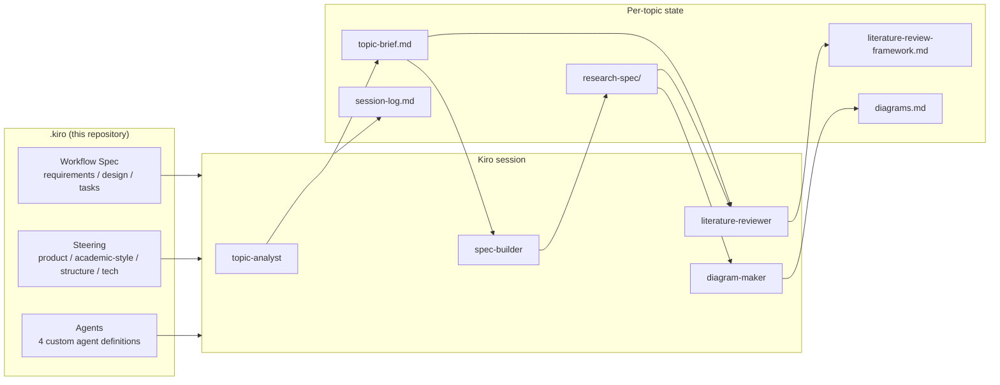

# Design — GhostAgent Research Workflow

## Overview

GhostAgent is implemented entirely as Kiro configuration. The runtime is Kiro
itself; the "program" is this Spec plus the steering documents; the workers
are four custom agents with single responsibilities; the shared state is a
set of Markdown files per topic. This design keeps every intermediate result
human-readable, diff-able and resumable.

## Architecture



## Components and Interfaces

### topic-analyst
- **Input:** free-text topic idea (chat message).
- **Output:** `topic-brief.md` (refined topic, scope in/out, 3–5 research questions, key terms).
- **Gate:** student confirmation required before Stage 2.

### spec-builder
- **Input:** confirmed `topic-brief.md`.
- **Output:** `research-spec/requirements.md`, `research-spec/design.md`, `research-spec/tasks.md` for the student's topic, modelled on this workflow Spec.
- **Rule:** the student's edits to these files are authoritative on re-runs.

### literature-reviewer
- **Input:** research questions from `topic-brief.md` + chapter plan from `research-spec/design.md`.
- **Output:** `literature-review-framework.md` — themes → debate → established → gap → thesis response, plus a reading plan.
- **Rule:** no invented citations; unknown sources are `[source needed]`.

### diagram-maker
- **Input:** `research-spec/design.md`.
- **Output:** `diagrams.md` with a study architecture diagram and a procedure flow diagram in Mermaid, each captioned with the Spec section it visualises.

## Data Models

All state is Markdown. The per-topic output layout (also in
`.kiro/steering/structure.md`):

```text
output/<topic-slug>/
├── topic-brief.md
├── research-spec/
│   ├── requirements.md
│   ├── design.md
│   └── tasks.md
├── literature-review-framework.md
├── diagrams.md
└── session-log.md
```

`<topic-slug>` is the kebab-case short form of the refined topic, chosen by
`topic-analyst` and recorded in the Topic Brief.

## Correctness Properties

- **P1 — Spec primacy:** if an output and the Research Spec disagree, the Spec wins and the output is regenerated.
- **P2 — No fabricated provenance:** every citation-shaped string in any output was either supplied by the student or is the literal marker `[source needed]`.
- **P3 — Resumability:** given only the per-topic state folder, a fresh Kiro session can identify the current stage and continue without regenerating completed stages.
- **P4 — Style conformance:** every output passes the rules in `.kiro/steering/academic-style.md` (structure, tone, terminology) before it is presented.
- **P5 — Task order:** a task in `tasks.md` is only marked complete when all tasks it depends on are complete.

## Error Handling

- **Vague topic** (no identifiable subject or population): `topic-analyst` asks one clarifying question instead of guessing a scope.
- **Contradictory student edits** (e.g. a research question removed from the brief but present in the Spec): `spec-builder` flags the conflict in the Session Log and asks which version stands.
- **Invalid Mermaid** produced by `diagram-maker`: the agent validates the block against Mermaid syntax rules in its prompt and regenerates before writing `diagrams.md`.

## Testing Strategy

- **Golden example:** `examples/sample-run/` freezes one full run; changes to the Spec, steering or agents are checked by re-running the sample topic and diffing the shape (sections, markers, diagram validity) of the outputs.
- **Property checks:** P2 is checked by scanning outputs for citation patterns not present in student input; P5 is checked by reading `tasks.md` dependency order.
- **Manual acceptance:** each requirement's acceptance criteria in `requirements.md` map to one stage walkthrough in `docs/USER_GUIDE.md`.
