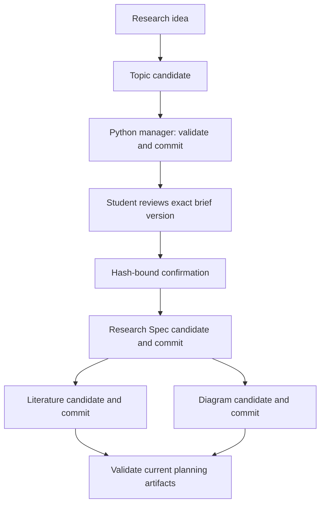

# Design — GhostAgent Research Workflow

Kiro produces research content. A Python standard-library executable manages the lifecycle of that content; no web server or database is required.

## Components

| Component | Responsibility |
| --- | --- |
| research-coordinator | Resume, select the next stage and request scope approval |
| Four research agents | Generate topic, Spec, literature framework and diagram candidates |
| ghostagent.py | Init, status, confirm, commit and validate |
| Workflow Spec | Requirements for this software, under .kiro/specs/ |
| Per-topic Research Spec | The student's own requirements, method, chapter plan and tasks |
| State and session log | Committed hashes, scope approval and ordered event history |

## State model and dependencies

Each topic has `.ghostagent-state.json` schema 1: topic slug, monotonically increasing revision, `confirmed_brief` SHA256, per-stage saved input/output hashes and ordered events. Event timestamps are timezone-aware local ISO values. State has no absolute machine paths. The manager derives `session-log.md` from events; previous entries persist exactly. A process lock file persists as working data.

`topic` depends on input.md. `spec` depends on topic-brief.md and current scope confirmation. Both `literature` and `diagrams` depend on topic-brief.md plus all three Spec files. Saved input hashes and recursive dependency readiness determine freshness. A stage fingerprint binds current inputs, current stage outputs and applicable confirmation; a candidate cannot publish against a changed base.

Direct edits are not silently committed: status marks them modified. Upstream changes propagate staleness. A brief's changed bytes revoke approval at recommit and immediately block downstream publication even before recommit. A byte-identical recommit does not force irrelevant regeneration. The next actionable stage is derived rather than stored as a second source of truth.

## Commit and failure model

Under an OS-level lock: recover a pending transaction; load state; verify the expected base token and dependencies; read every candidate; merge existing protected blocks; validate all candidates; construct the next state and event log; durably write a journal; atomically replace each document and the log; replace state last; remove the journal.

Atomic replacement applies to individual files. This is a recoverable multi-file publication, not snapshot isolation for external readers. Recovery verifies all before/after hashes before proceeding and rejects conflicts with outside edits. OS locks release if a process crashes. External editors are not locked; the base token detects edits up to commit validation, but editors must not concurrently change final artifacts during publication. The manager creates no historical backup.

## Student-edit protocol

Named `student-edit:stable-id` blocks match across heading moves. Anonymous blocks match their enclosing Markdown heading. Original block contents replace candidate contents. Removed, renamed, duplicate, nested, malformed or unclosed blocks reject publication before writes. Outside-block edits are hash-visible but need agent reconciliation. Semantic brief/Spec conflicts require student input.

## Validation boundary

The executable checks stage freshness, exact approval binding, expected headings, contiguous topic RQs, unknown RQ references, requirements coverage, task IDs/order/completed prerequisites, Mermaid fences/flowchart headers and caption presence. Citation-shaped strings generate review warnings; this heuristic cannot prove provenance. Source-needed placeholders are permitted for a framework.

It cannot establish source truth, infer missing field claims, judge methodology, authenticate approval, validate full Mermaid grammar or demonstrate live Kiro agent loading. Those are distinct runtime, rendering and academic acceptance checks. Prompt compliance remains a Kiro/model behavior, not a Python guarantee.

## Example and acceptance

The frozen example was assembled through manager commits; its confirmation event explicitly records simulated fixture review. It contains a complete proposed research plan, with research tasks unchecked. Real Kiro execution, renderer acceptance and demo-video accuracy remain separate acceptance items. Operational tests should cover blocked unconfirmed commits, dependency propagation, protected edits, obsolete fingerprints, interrupted publication and conflicting recovery, not merely JSON parsing.
