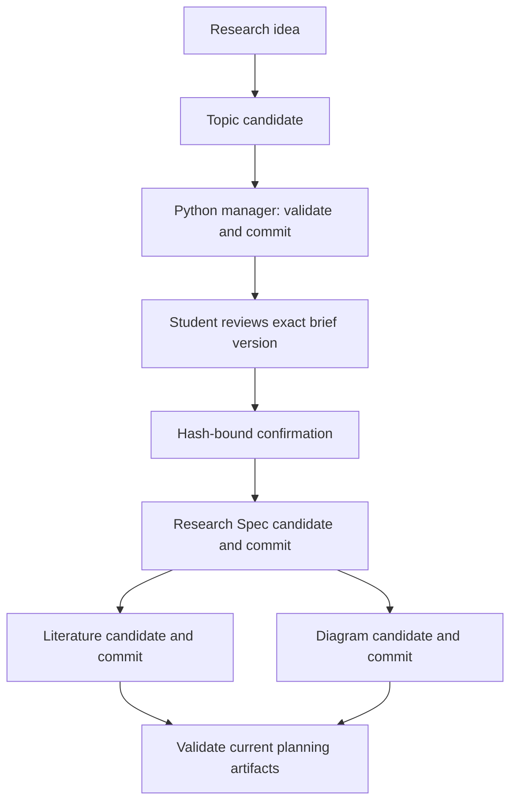

# GhostAgent — Architecture

Kiro produces research content. A Python standard-library executable manages the lifecycle of that content; the CLI and offline UI need no server or database. An optional local HTTP bridge connects the UI to the same manager.

## Components

| Component | Responsibility |
| --- | --- |
| research-coordinator | Resume, select the next stage and request scope approval |
| Four research agents | Generate topic, Spec, literature framework and diagram candidates |
| ghostagent.py | Init, status, confirm, commit and validate |
| Workflow Spec | Requirements for this software, under .kiro/specs/ |
| Per-topic Research Spec | The student's own requirements, method, chapter plan and tasks |
| State and session log | Committed hashes, scope approval and ordered event history |

## File-based frontend

`frontend/index.html`, `styles.css` and `app.js` implement a screenshot-inspired research workspace without a server. `sample-data.js` embeds sample documents, manager status and events. `export_sample.py` refreshes it only after successful manager validation. Mermaid 10.9.5 is bundled for offline SVG rendering with its license.

Folder imports compute SHA-256 on original file bytes and mirror canonical manager fingerprint serialization, deriving current, modified, stale, missing and untracked states. These are freshness checks, not structural validation or journal recovery. The UI never invents Kiro progress or treats research task completion as planning-stage completion.

Markdown escapes source HTML; Mermaid uses strict mode. Browser drafts keyed by topic and brief hash do not write original files. Exports include Markdown, store-mode ZIPs with complete candidate stages and fingerprints, archival draft JSON and SVG. Offline exports can be published with the manager CLI. In connected mode, explicit UI actions publish through the bridge; there is no arbitrary command input in the frontend. Explicit generation requests invoke a fixed Kiro CLI command through the backend.

The interface follows the screenshots' dark palette, multi-agent cards and split document/diagram views. It does not implement the screenshots' unverified statistical agents. Responsive layouts collapse cards and panels on narrow screens.

## Local workflow bridge

`workflow_server.py` serves the existing UI and `/api/session`, `/api/projects`, `/api/snapshot` plus POST `/api/init`, `/api/copy-sample`, `/api/confirm`, `/api/commit`, `/api/validate`. It binds loopback only. Host and Origin checks, cross-site request rejection and a random process token on mutations constrain browser access. Only frontend assets are served. API input paths are fixed stage document names and output identifiers; the sample is read-only. No shell command or arbitrary file-read endpoint is exposed.

`frontend/workflow.js` adds the connected workflow view without breaking direct-file preview. Snapshots load formal files, status, events and validation under the manager lock. Writes reuse manager functions, complete-stage validation, protected-block preservation and journal recovery. Candidate bodies are staged in a temporary directory and removed after the operation. The server does not bypass the brief confirmation gate or inherit fixture approval on sample copy.

The frontend retains stage fingerprints in browser drafts across refreshes and rejects silent rebasing. An explicit reconciliation flow displays current formal documents beside preserved candidates and requires acknowledgement before using the newly read base. Confirmation displays the formal brief and posts the reviewed hash only after an explicit checkbox. The manager detects edits between review and submission. Other pending stage drafts remain pinned after an upstream commit.

The bridge is a local single-user interface, not a public authenticated service. It can invoke the configured Kiro CLI for candidate generation; provenance review and academic acceptance remain separate. API validation returns incomplete errors as data rather than falsely reporting readiness.

## Kiro candidate executor

`kiro_generation.py` implements persistent asynchronous jobs. GET `/api/kiro/runtime`, `/api/kiro/jobs?id=...`, `/api/kiro/job?job=...` expose readiness, history and bounded logs. Token-protected POST `/api/kiro/generate` and `/api/kiro/cancel` start and stop jobs. CLI selection is a server startup setting, never a browser-provided shell command. Native executable and explicit WSL distribution modes are supported, with subprocess timeouts and fixed argv (`shell=False`).

Under the manager lock, generation verifies stage dependencies, approval and the browser's current fingerprint, then captures a formal snapshot. It releases the lock before calling Kiro. Each job runs with a dedicated candidate-only agent (empty tools/resources/MCP) in its own runtime directory. Snapshot and requirements are piped through stdin; output must contain exactly one bounded JSON envelope. The selected role's output schema is enforced with the manager's structural checks and protected-block handling. Interactive agent definitions are unchanged and retain their existing CLI workflow semantics.

`frontend/kiro.js` provides generation requests, runtime diagnosis, job polling, real logs and candidate review. Successful results retain their original fingerprint; a changed base flags the result stale. Candidate review uses the existing commit modal without rebasing. Publishing still requires the explicit manager-backed commit and exact-scope confirmation. Failure output is never presented as a completed stage. Authentication stays in the Kiro environment; the bridge does not collect keys. The configured key is redacted from captured logs.

Jobs persist as working data under `output/.kiro-jobs/`; an in-progress job becomes interrupted on restart. One active job per topic is permitted. Stdout and stderr have size bounds, generation has a deadline, and cancellation terminates the launched process tree on Windows. Cancellation of a WSL client cannot guarantee immediate termination of every Linux descendant; only tool-less candidate generation is used. No OS sandbox is claimed, and global Kiro hooks/policies still apply. CLI availability checks are not successful AI-generation evidence.

## State model and dependencies

Each topic has `.ghostagent-state.json` schema 1: topic slug, monotonically increasing revision, `confirmed_brief` SHA256, per-stage saved input/output hashes and ordered events. Event timestamps are timezone-aware local ISO values. State has no absolute machine paths. The manager derives `session-log.md` from events; previous entries persist exactly. A process lock file persists as working data.

`topic` depends on input.md. `spec` depends on topic-brief.md and current scope confirmation. Both `literature` and `diagrams` depend on topic-brief.md plus all three Spec files. Saved input hashes and recursive dependency readiness determine freshness. A stage fingerprint binds current inputs, current stage outputs and applicable confirmation; a candidate cannot publish against a changed base.

Direct edits are not silently committed: status marks them modified. Upstream changes propagate staleness. A brief's changed bytes revoke approval at recommit and immediately block downstream publication even before recommit. A byte-identical recommit does not force irrelevant regeneration. The next actionable stage is derived rather than stored as a second source of truth.

## Commit and failure model

Under an OS-level lock: recover a pending transaction; load state; verify the expected base token and dependencies; read every candidate; merge existing protected blocks; validate all candidates; construct the next state and event log; durably write a journal; atomically replace each document and the log; replace state last; remove the journal.

Atomic replacement applies to individual files. This is a recoverable multi-file publication, not snapshot isolation for external readers. Recovery verifies all before/after hashes before proceeding and rejects conflicts with outside edits. OS locks release if a process crashes. External editors are not locked; the base token detects edits up to commit validation, but editors must not concurrently change final artifacts during publication. The manager creates no historical backup.

## Student-edit protocol

Named `student-edit:stable-id` blocks match across heading moves. Anonymous blocks match their enclosing Markdown heading. Original block contents replace candidate contents. Removed, renamed, duplicate, nested, malformed or unclosed blocks reject publication before writes. Outside-block edits are hash-visible but need agent reconciliation. Semantic brief/Spec conflicts require student input.

## Validation boundary

The executable checks stage freshness, exact approval binding, expected headings, contiguous topic RQs, unknown RQ references, requirements coverage, task IDs/order/completed prerequisites, Mermaid fences/flowchart headers and caption presence. Citation-shaped strings generate review warnings; this heuristic cannot prove provenance. Source-needed placeholders are permitted for a framework.

It cannot establish source truth, infer missing field claims, judge methodology, authenticate approval, validate full Mermaid grammar or demonstrate live Kiro agent loading. Those are distinct runtime, rendering and academic acceptance checks. Prompt compliance remains a Kiro/model behavior, not a Python guarantee.

## Example and acceptance

The frozen example was assembled through manager commits; its confirmation event explicitly records simulated fixture review. It contains a complete proposed research plan, with research tasks unchecked. Real Kiro execution, renderer acceptance and demo-video accuracy remain separate acceptance items. Operational tests should cover blocked unconfirmed commits, dependency propagation, protected edits, obsolete fingerprints, interrupted publication and conflicting recovery, not merely JSON parsing.
