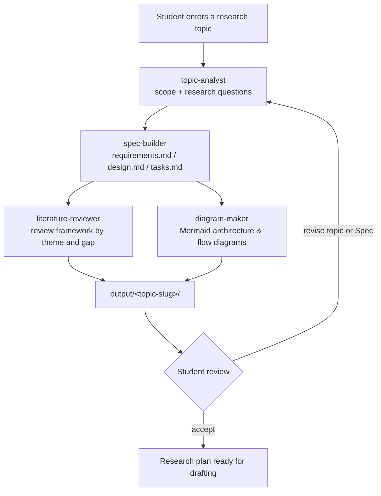

# GhostAgent — Architecture

## 1. Overview

GhostAgent is an agentic research workflow implemented as Kiro configuration:
Specs define *what* the workflow must do, steering documents define *how* every
output must look, and custom agents each perform one stage of the work. There is
no separate application server: Kiro is the runtime, the Spec files are the
program, and the Markdown outputs are the work products.

Design goals:

1. **Structure before text** — no chapter drafting until requirements and design exist.
2. **One source of truth** — the Spec under `.kiro/specs/` is the shared long-term memory for all agents and sessions.
3. **Single-responsibility agents** — each agent can be reviewed, improved and re-run independently.
4. **Consistency by steering, not by prompting** — style rules live in `.kiro/steering/` and apply automatically.
5. **Verifiable progress** — every stage maps to checkable tasks in `tasks.md` and to acceptance criteria in `requirements.md`.

## 2. Workflow

### Stage details

**Stage 1 — Topic analysis (`topic-analyst`)**
Input: one free-text idea. Output: refined topic statement, scope boundaries
(included / excluded), 3–5 candidate research questions ordered by importance,
and key terms with short definitions. The student confirms or edits the scope
before anything else is generated.

**Stage 2 — Spec generation (`spec-builder`)**
Input: the confirmed scope. Output: a Spec instance for this topic containing
research requirements (EARS), a research design (method outline, chapter plan,
data/instrument needs if any), and a task list sequenced so each task depends
only on earlier outputs.

**Stage 3 — Literature review framework (`literature-reviewer`)**
Input: research questions. Output: a framework document organised as
themes → representative debates → gaps → how this thesis addresses each gap,
plus a reading plan (what to search, where, in what order). The framework is a
structure with guidance notes, not fabricated citations: source slots are
marked `[source needed]` until the student inserts verified references
(see *Academic integrity* below).

**Stage 4 — Diagrams (`diagram-maker`)**
Input: the research design. Output: Mermaid diagrams — a study architecture
diagram (components and data flow of the planned research) and a process flow
diagram (the research procedure step by step). Mermaid is used so diagrams are
version-controllable text that renders in GitHub, Kiro and most editors.

**Stage 5 — Review loop**
The student reviews outputs against the acceptance criteria. Any change to the
topic re-enters at Stage 1; any change to structure re-enters at Stage 2. The
Spec is updated in place, so all downstream documents stay consistent.

## 3. Components

| Component | Location | Role |
| --- | --- | --- |
| Workflow Spec | `.kiro/specs/ghostagent-research-workflow/` | Defines the workflow itself: requirements, design, tasks |
| Product steering | `.kiro/steering/product.md` | Product definition loaded into every session |
| Academic style steering | `.kiro/steering/academic-style.md` | Writing rules enforced on all outputs |
| Structure steering | `.kiro/steering/structure.md` | Output locations and file naming |
| Tech steering | `.kiro/steering/tech.md` | Format and tooling conventions |
| Agents | `.kiro/agents/*.json` | One custom agent per workflow stage |
| Outputs | `output/<topic-slug>/` (generated, git-ignored) | The student's actual research documents |
| Examples | `examples/sample-run/` | A frozen sample run for reviewers |

## 4. Data model

The workflow manipulates only Markdown documents:

- **Topic brief** — `topic-brief.md`: refined topic, scope, research questions, key terms.
- **Research Spec** — `research-spec/`: `requirements.md`, `design.md`, `tasks.md` for the student's own topic (generated by `spec-builder`, modelled on the workflow Spec).
- **Literature review framework** — `literature-review-framework.md`.
- **Diagrams** — `diagrams.md`: Mermaid blocks with captions.
- **Session log** — `session-log.md`: what was generated, when, and what the student changed, so work can resume in a later session.

## 5. Academic integrity rules

These rules are enforced by `.kiro/steering/academic-style.md` and are part of
the design, not an afterthought:

1. GhostAgent produces **structure, plans and frameworks** — the student writes the thesis.
2. **No fabricated citations.** Unknown sources are marked `[source needed]`; agents never invent authors, titles, years or DOIs.
3. Every generated claim about a field is phrased as guidance to verify, not as a sourced fact.
4. The student remains the author of record for all submitted academic work.

## 6. Extensibility

- Add a stage = add one agent JSON + one section in the Spec's `tasks.md`.
- Change the academic style = edit one steering file; every agent picks it up.
- Support a new discipline = add a steering file with field-specific terminology and structure, scoped to that workspace.
