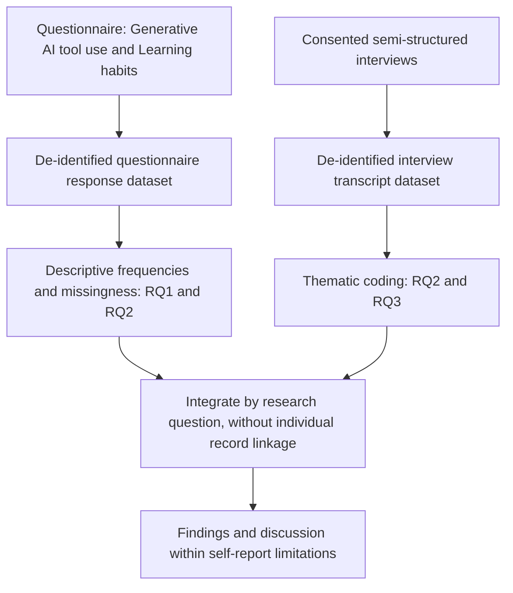
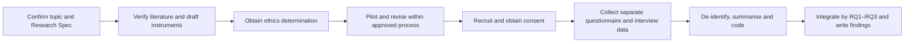

# Diagrams — AI Tools and Learning Habits

Illustrative Stage 4 diagrams derived from research-spec/design.md. The manager checks fences and flowchart headers, not full rendering; actual rendering must be checked separately.

## Study architecture

Caption: separate datasets and RQ-level integration; visualises research-spec/design.md, "Method outline".

## Research procedure

Caption: sequence of the planned study, including ethics and consent; visualises research-spec/design.md, "Procedure".

