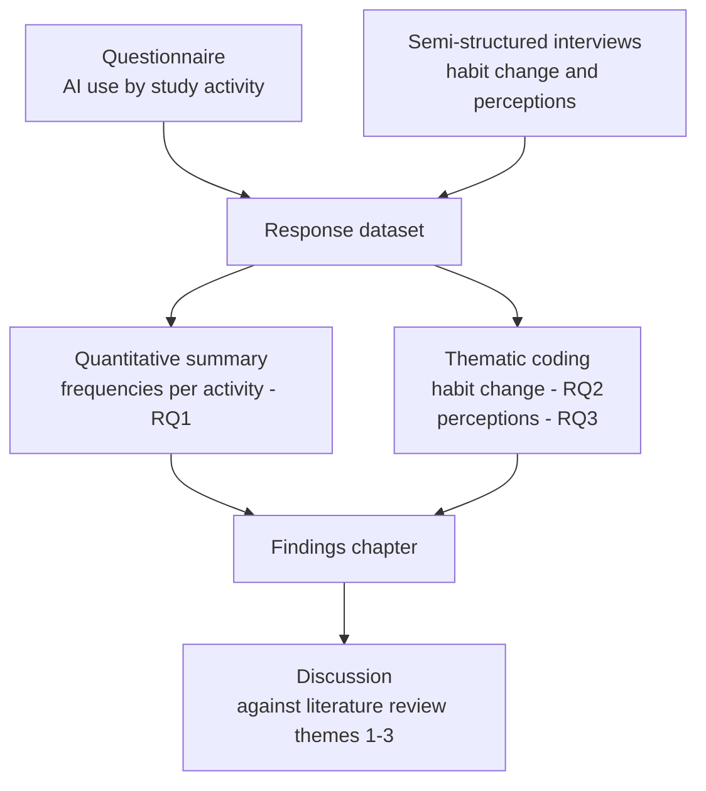
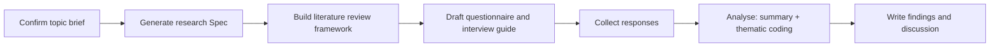

# Diagrams — AI Tools and Learning Habits

Produced by `diagram-maker` (Stage 4) from the research design.

## Study architecture

*Caption: components of the planned study and the flow of data between them.
Visualises research-spec/design.md, "Method outline".*

## Research procedure

*Caption: the study executed in order. Visualises research-spec/design.md,
"Procedure".*

