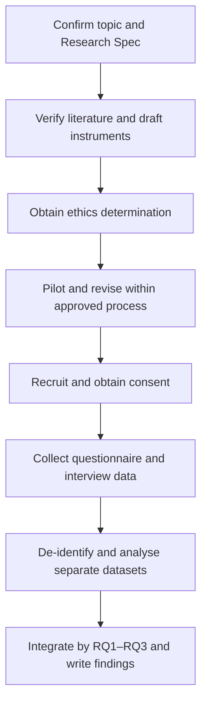

# Research Design — AI Tools and Learning Habits

Illustrative Stage 2 plan for RQ1–RQ3. The design uses a single-university questionnaire and follow-up semi-structured interviews; it does not establish causal effects.

## Chapter plan

1. Introduction: scope, RQ1–RQ3 and terms from topic-brief.md.
2. Literature review: use by activity, self-reported changes and Perceived effect.
3. Methodology: recruitment, instruments, ethics and analysis.
4. Findings: descriptive questionnaire summaries and interview themes mapped to the RQs.
5. Discussion: compare supported findings with verified literature and explain limitations.
6. Conclusion: answer the RQs within the stated scope.

## Method outline

Recruit volunteer undergraduate students from one university after the required ethics review. Determine a feasible recruitment target with the supervisor rather than inventing a statistically justified sample size. Eligibility, recruitment channels and the final target must be specified before recruitment.

The questionnaire asks about Generative AI tool use during the last four weeks for the five Learning habits in the brief (RQ1). It asks respondents to describe direction of change since first use, with unchanged and unsure choices (RQ2), and Perceived effect and concerns for those same activities (RQ3). Non-users can answer relevant perception questions and skip change-since-use questions. Interview prompts seek concrete examples and contradictory cases.

Keep the questionnaire response dataset and interview transcript dataset separate. Summarise questionnaire frequency and missingness descriptively for RQ1 and RQ2. Code de-identified interviews thematically for RQ2 and RQ3 and compare the two evidence streams at the level of RQs, not by unconsented individual linkage. A separate opt-in contact form is not linked to survey responses. Obtain separate interview consent, explain withdrawal limits, minimise identifiers and document restricted access and the approved retention period.

<!-- student-edit:method-decisions -->
Supervisor decisions pending: recruitment target, approved storage location, retention period and final questionnaire wording. Do not treat these as approved merely because the planning workflow is complete.
<!-- /student-edit -->

## Procedure

Confirm the topic; prepare the Research Spec and a source-verification reading plan; draft instruments and ethics materials; obtain the required ethics determination; pilot and revise under the approved process; recruit and obtain consent; collect questionnaire responses and interviews; de-identify, summarise and code; integrate by RQ; write and review the thesis.

## Limitations

The single-university volunteer sample is not representative of all undergraduates. Recall and self-selection may bias reports. Cross-sectional self-reports and retrospective accounts cannot establish whether AI use caused Learning habit changes. Grades, observed behaviour and misconduct detection remain out of scope. Proposed literature gaps remain hypotheses until sources are read.
